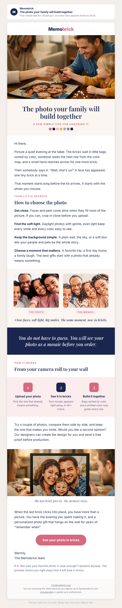

# Campaign draft: 2026-10-22 photo tips

## Preview

- Status: draft (dry run, not created in Omnisend). Redesigned 2026-10-12 with the memobrick-email-design skill; needs re-approval.
- Campaign name (Omnisend): Q4 | Oct 22 | Which Photo Makes the Best Mosaic (Warm)

## Creative concepts

1. **The photo is the first brick.** Big idea: the gift starts the moment you scroll your camera roll looking for "the one". Hook: that small thrill of finding it. Visual: a phone full of photos, then the mosaic. (No real image of a camera roll exists; would need an AI image.)
2. **The moment the faces appear.** Big idea: every tip is really a promise about one moment, when someone at the table says "wait, that's us!" as a face appears brick by brick. Hook: the family around the table on a quiet evening. Visual: real store photo of a family passing a brick across the table, then the same family selfie as photo and as mosaic.
3. **From the fridge to the wall.** Big idea: the photo stuck on the fridge deserves a place on the wall. Hook: the photos we love but never print. Visual: a fridge photo next to a hanging mosaic. (Would need AI images; weaker link to the tips.)

Chosen: **2, the moment the faces appear**, because it turns four practical tips into a feeling the reader can picture, and the live site already has real photos of that exact moment.

## Subject options

1. The photo your family will build together (chosen, 41 characters)
2. Which photo will make everyone lean in?
3. Which photo makes the best mosaic?

## Subject

The photo your family will build together

## Preview text

Four simple tips for choosing it, so every face appears brick by brick.

## Body

<!-- hero: https://mymemobrick.com/cdn/shop/files/Art-Gift-Kit-_-Buy-Now_-Personalise-Later-Memobrick-62824746.png?crop=region&crop_left=0&crop_top=472&crop_width=1024&crop_height=604&width=1200 | The photo your family will build together | A few simple tips for choosing it | A mother, father and toddler around a table, passing a single brick over their half-built photo mosaic -->

Hi [[contact.first_name|there]],

Picture a quiet evening at the table. The bricks wait in little bags sorted by color, someone reads the next row from the color map, and a small hand reaches across for one more brick.

Then somebody says it: *"Wait, that's us!"* A face has appeared, one tiny brick at a time.

That moment starts long before the kit arrives. It starts with the photo you choose.

### Four little secrets

## How to choose the photo

**Get close.** Faces and pets come alive when they fill most of the picture. If you can, crop in close before you upload.

**Find the soft light.** Daylight photos with gentle, even light keep every smile and every color easy to see.

**Keep the background simple.** A plain wall, the sky, or a soft blur lets your people and pets be the whole story.

**Choose a moment that matters.** A favorite trip, a first day home, a family laugh. The best gifts start with a photo that already means something.

<!-- pair: https://mymemobrick.com/cdn/shop/files/Custom-Bricked-Mosaic-Portrait-60x30_-Memobrick-59299574.png?crop=region&crop_left=125&crop_top=375&crop_width=500&crop_height=375 | https://mymemobrick.com/cdn/shop/files/Custom-Bricked-Mosaic-Portrait-60x30_-Memobrick-59299574.png?crop=region&crop_left=197&crop_top=50&crop_width=327&crop_height=245 | Close faces, soft light, big smiles. The same moment, now in bricks. | The photo | The mosaic -->

<!-- band: You do not have to guess. You will see your photo as a mosaic before you order. -->

### How it works

## From your camera roll to your wall

<!-- steps: Upload your photo: Pick the one that already means something. | See it in bricks: Your mosaic appears right away, in 40+ colors. | Build it together: Bags sorted by color and a printed color map guide every row. -->

Try a couple of photos, compare them side by side, and keep the one that makes you smile. Would you like a second opinion? Our designers can create the design for you and send a free proof before production.

<!-- image: https://mymemobrick.com/cdn/shop/files/Art-Gift-Kit-_-Buy-Now_-Personalise-Later-Memobrick-62824746.png?crop=region&crop_left=0&crop_top=1090&crop_width=1024&crop_height=446&width=1200 | A couple smiling at their finished family photo mosaic, framed and held up between them | The last brick goes in. The memory stays. -->

When the last brick clicks into place, you have more than a picture. You have the evening you spent making it, and a personalized photo gift that hangs on the wall for years of "remember when".

[See your photo in bricks](https://mymemobrick.com/?utm_source=omnisend&utm_medium=email&utm_campaign=2026-10-photo-tips)

Warmly,
The Memobrick team

P.S. Not sure your favorite photo is clear enough? Upload it anyway. The preview shows you right away how it will look in bricks.

## Call to action

- Button: See your photo in bricks
- Link: https://mymemobrick.com/?utm_source=omnisend&utm_medium=email&utm_campaign=2026-10-photo-tips
- Note: points to the homepage because the exact upload page URL is not recorded anywhere in the repo. Owner can swap in the upload page URL, keeping the same UTM parameters.

## Design notes

- Layout: hero image with serif headline, the build moment story, four tips, photo-to-mosaic pair, navy feeling band, 3-step "how it works" row, closing family moment image, one pink button, P.S.
- Images, all real product photos from the live site (each URL returned HTTP 200 on 2026-10-12, cropped by the store's image service, nothing uploaded):
  - Hero and closing image: `Art-Gift-Kit-_-Buy-Now_-Personalise-Later-Memobrick-62824746.png` (middle and bottom panels).
  - Pair: `Custom-Bricked-Mosaic-Portrait-60x30_-Memobrick-59299574.png` (the photo and its mosaic).
- These are Memobrick's own store photos, not customer photos. No names, quotes, or reviews are attached to the people shown. The frame in the closing image is not mentioned (frames are sold separately).
- Omnisend: paste `2026-10-22-photo-tips-omnisend.html` into a custom HTML block between Omnisend's own header and footer. Every image has alt text. Phone check: `2026-10-22-photo-tips-preview-phone.png`.

## Offer

None, by design: a helpful, no-offer email between the scheduled offer sends. `offers-calendar.md` now lists EARLYHOLIDAY20 (20%, active from 2026-10-12); if the owner wants it here, say so with `changes:` and it will be added as a P.S., not stacked with the automated 20% recovery or reactivation codes. The free design proof is an owner-confirmed option (Facts table), offered as optional.

## Audience segment

Warm Audience: Opened/Clicked 180d, Bought 365d, or New 60d (Omnisend segment 6ab3a047d52351bd34134eb5). This segment includes email-subscribed contacts only.

## Exclusions

- Recent purchasers in the last 14 days. No 14-day segment exists in Omnisend; use "Ordered in last 21 days - Exclude from deadline pushes" (6ab4c0626a51901673723534), which is slightly stricter, unless the owner prefers a new 14-day segment.
- Unsubscribed (excluded automatically: the Warm segment requires email subscribed).
- Also exclude "Unengaged 180d - Exclude from campaigns" (6ab3a050426f40d1edc2e691), matching the existing Q4 campaigns.

## Send time (ET)

Thursday 2026-10-22, 11:00 ET (15:00 UTC). No timezone optimization.

Frequency note: an Omnisend campaign "Q4 | Oct 20 | Early Bird 15%" is already scheduled to the same audience two days earlier, using an offer that is not in `offers-calendar.md`. If the owner pauses that campaign, this email can take the Tuesday Oct 20 slot instead.

## Success measure

- Purchases per delivered email (attributed orders / delivered).
- Revenue per recipient (attributed revenue / delivered).
- Benchmark: the Oct 6 Gift Guide Launch to the same Warm segment reached about $0.016 revenue per sent and 0.02% orders per sent. Target: beat both. Secondary: click rate above the 0.8% recent Warm average.

## Checks

- No em dashes (`python3 marketing/tools/check.py copy` passes).
- No customer quotes, reviews, delivery promises, order-by dates, Miami claim, prices, or scarcity. The "Wait, that's us!" line is an imagined moment in the story, not a customer quote.
- Website creates the design; the free proof is offered only as an option, never as required.
- Design checklist (memobrick-email-design skill): looks special at a glance, one clear action, reads well at phone width, every claim true.
