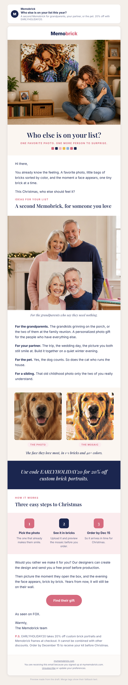

# Campaign draft: 2026-10-29 who else is on your list (past customers, Christmas)

## Preview

- Status: draft for owner approval. Not created, sent, or scheduled in Omnisend.
- Requested by: Eden, 2026-10-20 ("bring more visitors": a Christmas email to people who already bought a Memobrick).
- Campaign name (Omnisend): Q4 | Oct 29 | Who Else Is On Your List (Past Buyers)

## Creative concepts

1. **Who else is on your list?** Big idea: past buyers already know the gift works; the question is simply who gets the next one. Hook: a Christmas gift list, name by name (grandparents, partner, the pet, a sibling). Visual: real store photo of a mother and daughter hugging under their mosaic of that same hug, then the grandparents holding their mosaic, then a dog photo next to its mosaic (social planner images, cropped text-free).
2. **You already know the moment.** Big idea: give the moment you had (the face appearing, brick by brick) to someone else. Hook: memory of their own build. Visual: hands pressing bricks, a face half built. (The best "build moment" store photo was already used in the Oct 22 email, and the owner asked for a new first image, so this would need a new image.)
3. **The empty wall at Grandma's.** Big idea: one person, one wall, one photo of the grandkids. Hook: the grandparents who "need nothing". Visual: grandparents with their mosaic. (Strong, but it talks to only one recipient, and Eden's brief asks for several.)

Chosen: **1, who else is on your list**, with the opening lines borrowed from concept 2. It speaks to a buyer who already trusts us, gives four concrete people to picture (the family, couple, and pet gifts from the buyer profile), and every image it needs exists today.

## Subject options

1. Who else is on your list this year? (chosen, 35 characters)
2. Your next Memobrick is for someone else (39 characters)
3. Grandma, the dog, or your sister? (33 characters)

## Subject

Who else is on your list this year?

## Preview text

A second Memobrick for grandparents, your partner, or the pet. 20% off with EARLYHOLIDAY20.

## Body

<!-- hero: https://mymemobrick.com/cdn/shop/files/Custom-Bricked-Mosaic-Portrait-30x20_-Memobrick-59268336.png?width=1200 | Who else is on your list? | One favorite photo. One more person to surprise. | A mother and daughter hugging on a living room floor, below a large brick mosaic on the wall that shows the same hug -->

Hi [[contact.first_name|there]],

You already know the feeling. A favorite photo, little bags of bricks sorted by color, and the moment a face appears, one tiny brick at a time.

This Christmas, who else should feel it?

### Ideas for your list

## A second Memobrick, for someone you love

<!-- image: 2026-10-29-who-else-grandparents.jpg | An older couple smiling by a fireplace with a garland, holding a square brick mosaic of their own faces | For the grandparents who say they need nothing. -->

**For the grandparents.** The grandkids grinning on the porch, or the two of them at the family reunion. A personalized photo gift for the people who have everything else.

**For your partner.** The trip, the wedding day, the picture you both still smile at. Build it together on a quiet winter evening.

**For the pet.** Yes, the dog counts. So does the cat who runs the house.

**For a sibling.** That old childhood photo only the two of you really understand.

<!-- pair: 2026-10-29-who-else-dog-photo.jpg | 2026-10-29-who-else-dog-mosaic.jpg | The face they love most, in 1×1 bricks and 40+ colors. | The photo | The mosaic -->

<!-- band: Use code EARLYHOLIDAY20 for 20% off custom brick portraits. -->

### How it works

## Three easy steps to Christmas

<!-- steps: Pick the photo: The one that already makes them smile. | See it in bricks: Upload it and preview the mosaic before you order. | Order by Dec 15: So it arrives in time for Christmas. -->

Would you rather we make it for you? Our designers can create the design and send you a free proof before production.

Then picture the moment they open the box, and the evening the face appears, brick by brick. Years from now, it will still be on their wall.

[Find their gift](https://mymemobrick.com/collections/the-gift-for-everyone?utm_source=omnisend&utm_medium=email&utm_campaign=2026-10-past-customers-xmas)

As seen on FOX.

Warmly,
The Memobrick team

P.S. EARLYHOLIDAY20 takes 20% off custom brick portraits and Memobrick frames at checkout. It cannot be combined with other discounts. Order by December 15 to receive your kit before Christmas.

## Call to action

- Button: Find their gift
- Link: https://mymemobrick.com/collections/the-gift-for-everyone?utm_source=omnisend&utm_medium=email&utm_campaign=2026-10-past-customers-xmas
- Why this page: it is the Custom Bricks Portrait collection, where EARLYHOLIDAY20 applies, and gift-collection visitors converted at 6.3% last holiday vs 3.4% for the home page (ads audit). Page returned HTTP 200 on 2026-10-20.

## Design notes

- Layout: hero image with serif headline, short memory opening, eyebrow and headline, grandparents image, four "for whom" lines, photo-to-mosaic pair (the pet), navy offer band, 3-step row ending on the Dec 15 order-by date, optional free proof, closing keepsake line, one pink button, "As seen on FOX", P.S. with the code terms.
- Images:
  - Hero: `https://mymemobrick.com/cdn/shop/files/Custom-Bricked-Mosaic-Portrait-30x20_-Memobrick-59268336.png?width=1200`. Real Memobrick store product image (30×20 product page), hosted, HTTP 200 on 2026-10-20. Alt: "A mother and daughter hugging on a living room floor, below a large brick mosaic on the wall that shows the same hug". The mosaic hangs without a frame claim; no frame is mentioned.
  - Grandparents: `2026-10-29-who-else-grandparents.jpg` (local, in this folder; **owner uploads it in Omnisend**). Illustration: AI image by the social planner (`marketing/social/planner/2026-W43/S-20261025-1.png`, already checked against product facts), cropped to remove its text and button. Alt: "An older couple smiling by a fireplace with a garland, holding a square brick mosaic of their own faces".
  - Pair: `2026-10-29-who-else-dog-photo.jpg` and `2026-10-29-who-else-dog-mosaic.jpg` (local; **owner uploads both in Omnisend**). Illustration: AI dog photo (social planner, `S-20261024-1-2.png`, cropped to remove text); the mosaic was designed in MemoBrick Studio (version 2026-10-16c) from that photo at 20 × 20" (64 × 64 studs, 14 colors; Studio auto settings with saturation 5 and warmth 20) and drawn with Studio's own brick style (owner request 2026-10-20). Alts: "The photo: a golden retriever smiling at the camera" and "The mosaic: the same golden retriever made of 1×1 bricks" (the preview tool writes alt text from the labels and caption).
- No person or pet in any image is presented as a customer: no names, quotes, reviews, or "our customer built this". The AI images are labeled as illustrations here.
- No offer appears inside any image; the code is in live text only (band and P.S.).
- Omnisend: paste `2026-10-29-who-else-on-your-list-omnisend.html` into a custom HTML block between Omnisend's own header and footer, then replace the three local image paths with the Omnisend image URLs after upload.

## Offer

EARLYHOLIDAY20, 20% off. Verified in Shopify (read-only) on 2026-10-20: active since 2026-10-12, no end date, no minimum, all customers, applies to these collections only: Custom Bricks Portrait (`the-gift-for-everyone`), Memobrick Frame, Artist Collection, Bricks and Accessories, Newest products, Best Sellers, AVADA Best Sellers. It does **not** combine with order, product, or shipping discounts. So the email says "20% off custom brick portraits", never "sitewide", and states no end date.

No stacking: past buyers may also hold the automated 20% Customer Reactivation code. Shopify's settings stop the two from combining, and this email does not mention the reactivation code.

Not claimed: delivery speed, free shipping (the code does not combine with the free US shipping over $125 discount, so it is left out), review counts, replacements, Fox News, NBC, or Yahoo.

## Audience segment

"Past Buyers - Subscribed (Q4 gifting)" (Omnisend segment `6ab3a04c426f40d1edc2e690`): email subscribed AND placed at least 1 Shopify order (any time). **9,007 contacts** on 2026-10-20 (Omnisend segment statistics). This existing segment matches Eden's definition exactly, so no new include segment is needed.

## Exclusions

- **Ordered in the last 30 days** (Eden's rule). No 30-day segment exists yet; the closest is "Ordered in last 21 days - Exclude from deadline pushes" (`6ab4c0626a51901673723534`, 48 contacts today). On approval, create a new segment "Ordered in last 30 days - Exclude" (one condition: event `placed order`, origin shopify, at least 1, in the last 30 days) and exclude it. If creating it fails, exclude the 21-day segment and say so in the run report.
- **"Unengaged 180d - Exclude from campaigns"** (`6ab3a050426f40d1edc2e691`), as on every Q4 campaign. It only holds people with no order in the last 365 days, so every buyer of the past year stays in; older buyers who have not opened or clicked in 180 days are left out (last November's cold send had a 4.7% unsubscribe rate).
- Final recipient count after exclusions: shown by Omnisend at scheduling; it will be recorded in the run report when the campaign is created.

## Send time (ET)

Thursday 2026-10-29, 10:00 ET (14:00 UTC). No timezone optimization.

Why this time:
- Not Tue Oct 27: that day at 11:00 ET the owner's "Q4 | Oct 27 | Early Bird LAST CALL 15%" already goes to Warm + Past Buyers, the same people. Thursday keeps two days between sends and five days before "Q4 | Nov 3 | Gift Ideas By Person" (Warm).
- Late October is when last year's gift season started to climb (Nov 2025: 371 orders, doubling the week of Nov 10). A past buyer who orders now has time to choose a photo, use the free proof if wanted, and still be far ahead of the Dec 15 order-by date.
- Morning ET: our buyer is mostly a US woman aged 35 to 64 who buys on her phone; a mid-morning send lands near the top of the inbox across US time zones (7:00 Pacific). Q4 campaigns so far went at 11:00 ET; 10:00 is one hour earlier so the West Coast sees it before work rather than after.

## Omnisend setup on approval

1. Confirm no campaign with this name exists (`get_campaigns` with `nameContains: "Who Else"`).
2. Create the 30-day exclusion segment (see Exclusions).
3. Create the campaign (`post_campaigns`): email, the subject and preview text above, body from `2026-10-29-who-else-on-your-list-omnisend.html` with the three uploaded image URLs, include `6ab3a04c426f40d1edc2e690`, exclude the 30-day segment and `6ab3a050426f40d1edc2e691`.
4. Set the campaign UTM tags (`put_campaigns_id_utm`) to source `omnisend`, medium `email`, campaign `2026-10-past-customers-xmas`. Omnisend tags links on its own with `campaign: <name> (<id>)` (seen in Shopify on 2026-10-20); setting the tag keeps Shopify's report under the name Eden asked for.
5. Schedule for 2026-10-29T14:00:00Z (`post_campaigns_id_send`).

## Success measure

- Purchases per delivered email (attributed orders / delivered).
- Revenue per recipient (attributed revenue / delivered).
- Visits: Shopify sessions with `utm_campaign` = `2026-10-past-customers-xmas` (or the Omnisend tag).
- Benchmarks from the same audiences this fall (Omnisend reports): "Special | New Website Launch (Warm + Past Buyers)" 5,002 sent, 1 order, $89.15 ($0.018 per sent), 74 Shopify sessions; "Q4 | Oct 6 | Gift Guide Launch (Warm)" 1 order, $80.22 ($0.016 per sent), 55 sessions. Last year's best Q4 email reached about $0.064 per sent.
- Target: at least 5 orders and $0.05 revenue per recipient, and more than 100 Shopify sessions.

## Checks

- No em dashes (`python3 marketing/tools/check.py copy` passes).
- Every fact from `offers-calendar.md` or Shopify read-only data: EARLYHOLIDAY20 (collections checked), Dec 15 order-by date, free design proof (optional), "As seen on FOX" only.
- No delivery speed, replacement promise, review count, customer quote, or scarcity. "You already know the feeling" speaks to past buyers; the moments described are imagined scenes, not quotes.
- Design checklist (memobrick-email-design): reviewed on both previews; see the run report.
