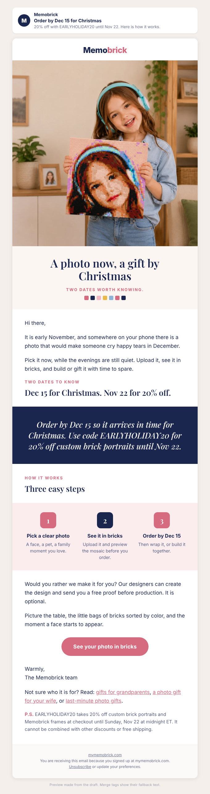

# Campaign draft: 2026-11-10 Order by Dec 15 (Warm)

## Preview

- Requested by: growth director task board, 2026-11-02 (Marcela): the "Order by Dec 15" email for Nov 4 to 11, merged with A-2026W44-052 (past buyers) and A-2026W44-060 (dog email) so Eden decides one list send and one past-buyer send. This is the list send. The past-buyer send is `2026-11-10-second-mosaic-past-buyers.md`.
- Campaign name (Omnisend): Q4 | Nov 10 | Order By Dec 15 (Warm)
- Replaces: `2026-11-12-your-dog-in-bricks.md` (A-2026W44-060). The dog page has had 62 referred sessions and 0 carts in its first five days (sales data, Nov 2), so the dog email waits until carts improve. Approve this instead of 060, not as well.

## Creative concepts

1. **The date on the calendar.** Big idea: Christmas has a real order-by date, Dec 15, and a real code date, Nov 22; give the reader a calm plan, not pressure. Hook: the quiet minute when you realize it is November and the gift list is still blank. Visual: a girl smiling with her 20×20 mosaic (real store product photo) as the hero, three steps, a navy band with the two dates.
2. **Pick your person.** Big idea: the hard part is who and what, so the email is a short map (grandparents, wife, last-minute) that links to the three Christmas guides. Hook: "Who is it for?" Visual: the 30×40 portrait wall photo. Risk: three destinations dilute the one action.
3. **The evening it takes.** Big idea: the gift is the evening you build it, so start early enough to enjoy it. Hook: a table, little bags sorted by color, a quiet night in December. Visual: needs a build-moment photo we do not have as a fresh image.

Chosen: **1**, with the "pick your person" links from concept 2 kept small under the button. It carries the two real dates (the best lever on record: Nov 2025 "Final Hours", about $0.064 per sent), uses a real store photo, and keeps one big button.

## Subject options

1. Order by Dec 15 for Christmas (28 characters, chosen)
2. Your Christmas gift has a date (31 characters)
3. 20% off, and the date to know (29 characters)

## Subject

Order by Dec 15 for Christmas

## Preview text

20% off with EARLYHOLIDAY20 until Nov 22. Here is how it works.

## Body

<!-- hero: https://mymemobrick.com/cdn/shop/files/Custom-Memobrick-Photo-Mosaic-20x20.png?width=1200 | A photo now, a gift by Christmas | Two dates worth knowing. | A smiling girl in headphones holding a square brick mosaic of her own portrait in a living room -->

Hi [[contact.first_name|there]],

It is early November, and somewhere on your phone there is a photo that would make someone cry happy tears in December.

Pick it now, while the evenings are still quiet. Upload it, see it in bricks, and build or gift it with time to spare.

### Two dates to know

## Dec 15 for Christmas. Nov 22 for 20% off.

<!-- band: Order by Dec 15 so it arrives in time for Christmas. Use code EARLYHOLIDAY20 for 20% off custom brick portraits until Nov 22. -->

### How it works

## Three easy steps

<!-- steps: Pick a clear photo: A face, a pet, a family moment you love. | See it in bricks: Upload it and preview the mosaic before you order. | Order by Dec 15: Then wrap it, or build it together. -->

Would you rather we make it for you? Our designers can create the design and send you a free proof before production. It is optional.

Picture the table, the little bags of bricks sorted by color, and the moment a face starts to appear.

[See your photo in bricks](https://mymemobrick.com/pages/editor?utm_source=omnisend&utm_medium=email&utm_campaign=2026-11-order-by-dec-15)

Warmly,
The Memobrick team

Not sure who it is for? Read: [gifts for grandparents](https://mymemobrick.com/blogs/news/christmas-gifts-for-grandparents-from-grandkids?utm_source=omnisend&utm_medium=email&utm_campaign=2026-11-order-by-dec-15), [a photo gift for your wife](https://mymemobrick.com/blogs/news/photo-christmas-gift-for-wife?utm_source=omnisend&utm_medium=email&utm_campaign=2026-11-order-by-dec-15), or [last-minute photo gifts](https://mymemobrick.com/blogs/news/last-minute-personalized-christmas-gifts?utm_source=omnisend&utm_medium=email&utm_campaign=2026-11-order-by-dec-15).

P.S. EARLYHOLIDAY20 takes 20% off custom brick portraits and Memobrick frames at checkout until Sunday, Nov 22 at midnight ET. It cannot be combined with other discounts or free shipping.

## Call to action

- Button: See your photo in bricks
- Link: https://mymemobrick.com/pages/editor?utm_source=omnisend&utm_medium=email&utm_campaign=2026-11-order-by-dec-15
- Why this page: the web editor, where the reader uploads a photo and sees the mosaic (HTTP 200 on 2026-11-02). It is the step that comes right after the click. Three small text links to the Christmas guides sit under the sign-off for readers who need ideas first; they are not buttons.

## Design notes

- Layout: hero with serif headline, short opening, eyebrow and headline, navy band with the two dates, three steps ending on Dec 15, optional free proof, closing scene, one pink button, small "Read" line, P.S. with code terms.
- Images:
  - Hero: `https://mymemobrick.com/cdn/shop/files/Custom-Memobrick-Photo-Mosaic-20x20.png?width=1200`. Real Memobrick store product image (20×20 product page), HTTP 200 on 2026-11-02, looked at before use. Alt: "A smiling girl in headphones holding a square brick mosaic of her own portrait in a living room". Not presented as a customer. No frame mentioned.
- No customer name, quote, rating or count appears. No offer is printed inside any image; the code is live text only.
- Omnisend: paste `2026-11-10-order-by-dec-15-omnisend.html` into a custom HTML block between Omnisend's own header and footer.

## Offer

EARLYHOLIDAY20, 20%, ends 2026-11-22 23:59:59 ET (offers-calendar). Does not combine with other discounts or free shipping. Dec 15 order-by from the Facts table. No other code, deadline or delivery promise. Before the campaign is created, confirm in Shopify that the code still ends Nov 22.

## Audience segment

"Warm" (Omnisend segment `6ab3a047d52351bd34134eb5`).

## Exclusions

- Past Buyers - Subscribed `6ab3a04c426f40d1edc2e690` (they get the past-buyer version the same morning).
- Ordered in last 21 days - Exclude `6ab4c0626a51901673723534`.
- Unengaged 180d - Exclude `6ab3a050426f40d1edc2e691`.

## Send time (ET)

Tuesday 2026-11-10, 10:00 ET (15:00 UTC). No timezone optimization. One week after the Nov 3 Warm send and ten days before the Nov 20 Warm send.

## Success measure

- Purchases per delivered email and revenue per recipient.
- Shopify sessions with `utm_campaign` = `2026-11-order-by-dec-15`.
- Benchmarks: Oct 20 Early Bird 0.019% orders per delivered, $0.025 per recipient; Nov 2025 "Final Hours" about $0.064 per sent.
- Target: at least 3 orders.

## Checks

- Dates: Nov 22 and Dec 15 from offers-calendar. No delivery-speed, scarcity, review or count claim.
- Overlap: Nov 3 Gift Ideas (Warm) is the only earlier send this month; the Nov 20 "ends Sunday" email repeats the code date on purpose and uses a different image and angle.
