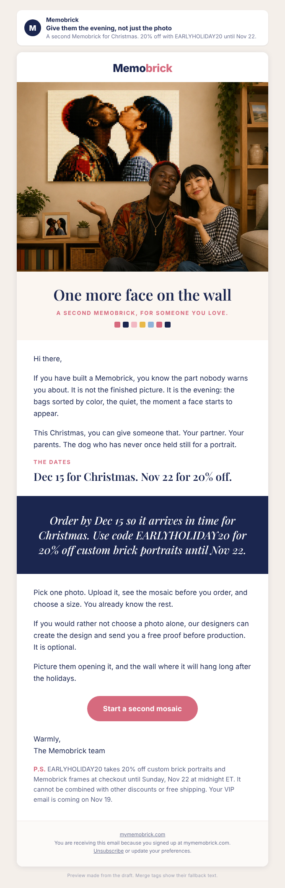

# Campaign draft: 2026-11-10 A second mosaic for Christmas (Past Buyers)

## Preview

- Requested by: growth director A-2026W44-052 (past-buyer "second mosaic for Christmas" email, about Nov 10) and the task board of 2026-11-02. This is the past-buyer send; the list send is `2026-11-10-order-by-dec-15.md`.
- Campaign name (Omnisend): Q4 | Nov 10 | Second Mosaic For Christmas (Past Buyers)
- Not about anyone's order: no order details, order links, or Post-Purchase content.
- Why it differs from Oct 29: that email ("Who else is on your list?", Past Buyers) had 25 clicks and 0 orders and no deadline. This one leads with the two real dates and one specific idea, a gift for the partner, and goes out nine days before the Nov 19 VIP email.

## Creative concepts

1. **Give the evening you had.** Big idea: what a past buyer remembers is the building evening; a second mosaic hands that evening to someone else. Hook: the quiet minute when a face first appears in the bricks. Visual: the couple and their kiss mosaic on the wall (real store photo).
2. **Two dates.** Big idea: pure deadline: Dec 15 and Nov 22, a short plain reminder to people who already know the product. Visual: a navy band only. Less emotional, strongest for conversion.
3. **For the one who has everything.** Big idea: the grandparent or sibling who says they need nothing. Visual: the grandparents illustration used on Oct 29. Risk: repeats the Oct 29 email.

Chosen: **1**, with concept 2's band inside it, so the reader feels the build moment and sees both real dates. It does not reuse the Oct 29 images.

## Subject options

1. Give them the evening, not just the photo (40 characters, chosen)
2. A second Memobrick, by Dec 15 (30 characters)
3. Your Memobrick code ends Nov 22 (32 characters)

## Subject

Give them the evening, not just the photo

## Preview text

A second Memobrick for Christmas. 20% off with EARLYHOLIDAY20 until Nov 22.

## Body

<!-- hero: https://mymemobrick.com/cdn/shop/files/Custom-Bricked-Mosaic-Portrait-40x30_-Memobrick-59270451.png?width=1200 | One more face on the wall | A second Memobrick, for someone you love. | A smiling couple sitting below a large brick mosaic on the wall that shows them in a kiss -->

Hi [[contact.first_name|there]],

If you have built a Memobrick, you know the part nobody warns you about. It is not the finished picture. It is the evening: the bags sorted by color, the quiet, the moment a face starts to appear.

This Christmas, you can give someone that. Your partner. Your parents. The dog who has never once held still for a portrait.

### The dates

## Dec 15 for Christmas. Nov 22 for 20% off.

<!-- band: Order by Dec 15 so it arrives in time for Christmas. Use code EARLYHOLIDAY20 for 20% off custom brick portraits until Nov 22. -->

Pick one photo. Upload it, see the mosaic before you order, and choose a size. You already know the rest.

If you would rather not choose a photo alone, our designers can create the design and send you a free proof before production. It is optional.

Picture them opening it, and the wall where it will hang long after the holidays.

[Start a second mosaic](https://mymemobrick.com/pages/editor?utm_source=omnisend&utm_medium=email&utm_campaign=2026-11-second-mosaic)

Warmly,
The Memobrick team

P.S. EARLYHOLIDAY20 takes 20% off custom brick portraits and Memobrick frames at checkout until Sunday, Nov 22 at midnight ET. It cannot be combined with other discounts or free shipping. Your VIP email is coming on Nov 19.

## Call to action

- Button: Start a second mosaic
- Link: https://mymemobrick.com/pages/editor?utm_source=omnisend&utm_medium=email&utm_campaign=2026-11-second-mosaic
- Why this page: the web editor (HTTP 200 on 2026-11-02); past buyers know it and can start straight away.

## Design notes

- Layout: hero with serif headline, memory opening, eyebrow and headline, navy band with the two dates, short "pick one photo" line, optional free proof, closing scene, one pink button, P.S.
- Images:
  - Hero: `https://mymemobrick.com/cdn/shop/files/Custom-Bricked-Mosaic-Portrait-40x30_-Memobrick-59270451.png?width=1200`. Real Memobrick store product image (40×30 product page), HTTP 200 on 2026-11-02, looked at before use. Alt: "A smiling couple sitting below a large brick mosaic on the wall that shows them in a kiss". Not presented as customers. No frame mentioned.
- No customer name, quote, rating or count. No offer printed inside an image.
- "If you have built a Memobrick" is conditional on purpose: past buyers may have given theirs away. The P.S. line about the Nov 19 VIP email assumes that campaign stays scheduled; drop it if the owner removes it.
- Omnisend: paste `2026-11-10-second-mosaic-past-buyers-omnisend.html` into a custom HTML block between Omnisend's own header and footer.

## Offer

EARLYHOLIDAY20, 20%, ends 2026-11-22 23:59:59 ET (offers-calendar). Does not combine with other discounts or free shipping. Dec 15 from the Facts table. The Nov 19 VIP email carries its own personal code; this email does not mention it. Confirm in Shopify before creating that EARLYHOLIDAY20 still ends Nov 22.

## Audience segment

Past Buyers - Subscribed `6ab3a04c426f40d1edc2e690`.

## Exclusions

- Ordered in last 21 days - Exclude `6ab4c0626a51901673723534`.
- Unengaged 180d - Exclude `6ab3a050426f40d1edc2e691`.

## Send time (ET)

Tuesday 2026-11-10, 10:00 ET (15:00 UTC). No timezone optimization. Twelve days after the Oct 29 past-buyer send and nine days before the Nov 19 VIP email.

## Success measure

- Purchases per delivered email and revenue per recipient.
- Shopify sessions with `utm_campaign` = `2026-11-second-mosaic`.
- Benchmarks: Oct 29 Who Else Is On Your List (same audience) 0 orders, $0 per recipient; Oct 14 reactivation $0.031 per recipient.
- Target: at least 2 orders. If it again gets 0, stop sending past buyers three gifting emails in a row and keep only the Nov 19 VIP.

## Checks

- Dates: Nov 22 and Dec 15 from offers-calendar. No scarcity, delivery-speed or count claims.
- Frequency: this audience would get Oct 29, Nov 10, Nov 19 (VIP), Nov 27 only if in Warm, plus the December countdowns. Eden can drop this send if three in 3 weeks is too many.
