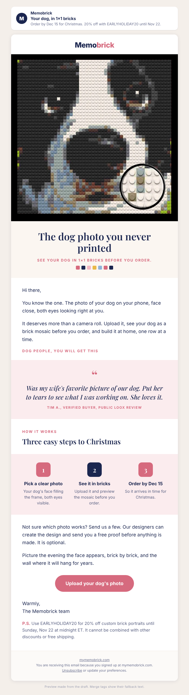

# Campaign draft: 2026-11-12 Your dog in bricks (Warm)

## Preview

- Requested by: growth director task board, 2026-10-30 (Task 2: gap email Nov 4 to 18). A gap the existing schedule does not cover: Nov 3 (gift ideas) is the last send until Nov 19 (VIP, Past Buyers) and Nov 20 (code ends Sunday).
- Campaign name (Omnisend): Q4 | Nov 12 | Your Dog In Bricks (Warm)

## Creative concepts

1. **The dog photo you never printed.** Big idea: every phone has a dog photo that deserves more than a camera roll. Hook: the one where the face fills the frame and both eyes are clear. Visual: the real 16×16 Memobrick dog close-up from the store (the face in 1×1 bricks, with the brick magnifier circle).
2. **For the dog person on your list.** Big idea: gift-guide angle for the brother, mom or friend whose dog is family. Hook: "the person who has everything, except their dog on the wall." Visual: the pink-and-purple dog with sunglasses mosaic on a living room wall (real store photo).
3. **The one who stayed.** Big idea: a quiet, sentimental email for people who lost a dog or have an old dog. Hook: the photo you keep close. Visual: needs an image that does not exist yet, and risks a heavy mood in a sales email.

Chosen: **1**. It has a real product photo that shows the brick detail, it leads straight to the live dog page the owner approved (Meta ad XMAS26 Dog v2 points there too), and a real public Loox review carries the feeling without inventing anything.

## Subject options

1. Your dog, in 1×1 bricks (23 characters, chosen)
2. The dog photo you never printed (31 characters)
3. A gift for the dog person on your list (38 characters)

## Subject

Your dog, in 1×1 bricks

## Preview text

Order by Dec 15 for Christmas. 20% off with EARLYHOLIDAY20 until Nov 22.

## Body

<!-- hero: https://mymemobrick.com/cdn/shop/files/Doggy-Eyes-Home-Decoration-Bricked-Mosaic-Portrait-16x16.png?width=1200 | The dog photo you never printed | See your dog in 1×1 bricks before you order. | A close-up of a black and white dog's face made of small square bricks, with a round magnifier showing the individual bricks -->

Hi [[contact.first_name|there]],

You know the one. The photo of your dog on your phone, face close, both eyes looking right at you.

It deserves more than a camera roll. Upload it, see your dog as a brick mosaic before you order, and build it at home, one row at a time.

### Dog people, you will get this

<!-- quote: Was my wife's favorite picture of our dog. Put her to tears to see what I was working on. She loves it. | Tim A., verified buyer, public Loox review -->

### How it works

## Three easy steps to Christmas

<!-- steps: Pick a clear photo: Your dog's face filling the frame, both eyes visible. | See it in bricks: Upload it and preview the mosaic before you order. | Order by Dec 15: So it arrives in time for Christmas. -->

Not sure which photo works? Send us a few. Our designers can create the design and send you a free proof before anything is made. It is optional.

Picture the evening the face appears, brick by brick, and the wall where it will hang for years.

[Upload your dog's photo](https://mymemobrick.com/pages/dog-brick-mosaic?utm_source=omnisend&utm_medium=email&utm_campaign=2026-11-your-dog-in-bricks)

Warmly,
The Memobrick team

P.S. Use EARLYHOLIDAY20 for 20% off custom brick portraits until Sunday, Nov 22 at midnight ET. It cannot be combined with other discounts or free shipping.

## Call to action

- Button: Upload your dog's photo
- Link: https://mymemobrick.com/pages/dog-brick-mosaic?utm_source=omnisend&utm_medium=email&utm_campaign=2026-11-your-dog-in-bricks
- Why this page: the live "Your Dog in Bricks" page, built for dog photos (HTTP 200 on 2026-10-30). It shows the 16×16, 20×20 and 30×30 kits, real public Loox dog reviews, the free proof and the Dec 15 and Nov 22 dates, and its date lines hide themselves after those dates.

## Design notes

- Layout: hero with serif headline, short opening, eyebrow, review quote block, three steps ending on Dec 15, optional free proof, closing line, one pink button, P.S. with code terms.
- Images:
  - Hero: `https://mymemobrick.com/cdn/shop/files/Doggy-Eyes-Home-Decoration-Bricked-Mosaic-Portrait-16x16.png?width=1200`. Real Memobrick product image from the store (HTTP 200 on 2026-10-30), looked at before use. Alt: "A close-up of a black and white dog's face made of small square bricks, with a round magnifier showing the individual bricks". No frame is mentioned or implied.
- The only person quoted is a public Loox review (Tim A., verified buyer, word for word, from the live dog page). No other quote, name, count or star rating appears. No offer is printed inside any image.
- The Christmas articles (wife, grandparents, last-minute) are not linked. The email has one destination, the dog page. They fit better in the Nov 3 gift-ideas send or a later gift-guide email.
- Omnisend: paste `2026-11-12-your-dog-in-bricks-omnisend.html` into a custom HTML block between the header and footer, as in the Nov 20 campaign.

## Offer

EARLYHOLIDAY20, 20%, ends 2026-11-22 23:59:59 ET (offers-calendar). Does not combine with other discounts or free shipping. Dec 15 order-by from the offers-calendar Facts table. No other code, deadline or delivery promise.

## Audience segment

"Warm" (Omnisend segment `6ab3a047d52351bd34134eb5`).

## Exclusions

- Past Buyers - Subscribed `6ab3a04c426f40d1edc2e690` (they get the Nov 19 VIP email).
- Ordered in last 21 days - Exclude `6ab4c0626a51901673723534`.
- Unengaged 180d - Exclude `6ab3a050426f40d1edc2e691`.

## Send time (ET)

Thursday 2026-11-12, 10:00 ET (15:00 UTC). No timezone optimization. Nine days after the Nov 3 Warm send and eight days before the Nov 20 Warm send.

## Success measure

- Purchases per delivered email and revenue per recipient.
- Shopify sessions with `utm_campaign` = `2026-11-your-dog-in-bricks`.
- Benchmarks: Oct 20 Early Bird 0.019% orders per delivered, $0.025 per recipient.
- Target: at least 2 orders. Dog landing page conversion from Meta traffic (see site-developer report) is the other read on this angle.

## Checks

- Dates: Nov 22 and Dec 15 from offers-calendar. Review quoted from public Loox as shown on the live page. No scarcity, delivery speed or count claims.
