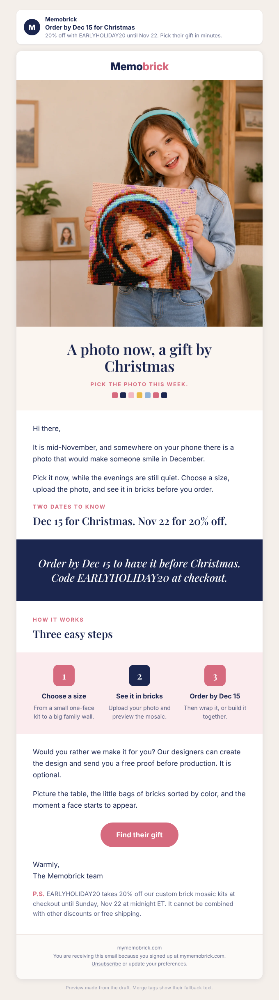

# Campaign draft: 2026-11-16 Order by Dec 15, gift collection (Warm)

## Preview

- Requested by: growth director task board (Marcela row, Nov 11 board): if Nov 16 to 18 has no send to Warm, propose one short "order by Dec 15, gift collection" email, no new code, EARLYHOLIDAY20 only as in the calendar. Omnisend read 2026-11-11: nothing is scheduled to Warm between the Nov 3 send and Nov 20.
- Campaign name (Omnisend): Q4 | Nov 16 | Order By Dec 15 Gift Collection (Warm)
- Built from: `2026-11-10-order-by-dec-15.md` (A-2026W45-003, expired Nov 9 undecided). Changes: send date, "mid-November" opening, one destination (the gift collection, the best entry page at 11.7% cart rate Nov 6 to 8; the editor had 2 sessions and 0 carts Oct 28 to Nov 8), and the three blog links removed so there is one action.
- Works with A-2026W44-060 (Nov 12 dog email) if the owner approves that today: Warm would get Nov 12, Nov 16, Nov 20, four days apart.

## Creative concepts

1. **The date on the calendar.** Big idea: Christmas has a real order-by date, Dec 15, and a real code date, Nov 22, so give the reader a calm plan, not pressure. Hook: the quiet moment in mid-November when the gift list is still blank. Visual: the smiling girl holding her 20×20 mosaic (real store product photo) as the hero, three steps, a navy band with the two dates.
2. **One photo, everyone on the list.** Big idea: a single gift idea that works for grandparents, a partner, a sibling, a pet lover, because the photo makes it theirs. Hook: "Who is still on your list?" Visual: needs a grid of several real mosaics; the store has single product shots only, so the grid would be crops of different listings and could look busy on a phone.
3. **The evening it takes.** Big idea: the gift is the evening you build it, so start early enough to enjoy it. Hook: a table, little bags sorted by color, a quiet night in December. Visual: the Nov 24 email already uses the table illustration; repeating it eight days apart wastes it.

Chosen: **1**. Real dates are the strongest lever on record (Nov 2025 "Final Hours", about $0.064 per sent), it uses a real store photo, and it lands on the page that turns visits into carts best.

## Subject options

1. Order by Dec 15 for Christmas (28 characters, chosen)
2. Your Christmas gift has a date (30 characters)
3. 20% off until Sunday the 22nd (29 characters)

## Subject

Order by Dec 15 for Christmas

## Preview text

20% off with EARLYHOLIDAY20 until Nov 22. Pick their gift in minutes.

## Body

<!-- hero: https://mymemobrick.com/cdn/shop/files/Custom-Memobrick-Photo-Mosaic-20x20.png?width=1200 | A photo now, a gift by Christmas | Pick the photo this week. | A smiling girl in headphones holding a square brick mosaic of her own portrait in a living room -->

Hi [[contact.first_name|there]],

It is mid-November, and somewhere on your phone there is a photo that would make someone smile in December.

Pick it now, while the evenings are still quiet. Choose a size, upload the photo, and see it in bricks before you order.

### Two dates to know

## Dec 15 for Christmas. Nov 22 for 20% off.

<!-- band: Order by Dec 15 to have it before Christmas. Code EARLYHOLIDAY20 at checkout. -->

### How it works

## Three easy steps

<!-- steps: Choose a size: From a small one-face kit to a big family wall. | See it in bricks: Upload your photo and preview the mosaic. | Order by Dec 15: Then wrap it, or build it together. -->

Would you rather we make it for you? Our designers can create the design and send you a free proof before production. It is optional.

Picture the table, the little bags of bricks sorted by color, and the moment a face starts to appear.

[Find their gift](https://mymemobrick.com/collections/the-gift-for-everyone?utm_source=omnisend&utm_medium=email&utm_campaign=2026-11-order-by-dec-15-gift)

Warmly,
The Memobrick team

P.S. EARLYHOLIDAY20 takes 20% off our custom brick mosaic kits at checkout until Sunday, Nov 22 at midnight ET. It cannot be combined with other discounts or free shipping.

## Call to action

- Button: Find their gift
- Link: https://mymemobrick.com/collections/the-gift-for-everyone?utm_source=omnisend&utm_medium=email&utm_campaign=2026-11-order-by-dec-15-gift
- Why this page: "The gift for everyone" collection lists every kit size from the 10×10 one-face kit up, plus the gift card (HTTP 200 on 2026-11-11). It was the best referred entry page Oct 28 to Nov 8 (278 sessions, 28 carts, 7 purchasing sessions). One destination only.

## Design notes

- Layout: hero with serif headline and "Pick the photo this week" subline, short opening, eyebrow and headline, navy band with the two dates, three steps ending on Dec 15, optional free proof, closing scene, one pink button, P.S. with code terms.
- Images:
  - Hero: `https://mymemobrick.com/cdn/shop/files/Custom-Memobrick-Photo-Mosaic-20x20.png?width=1200`. Real Memobrick store product image (20×20 product page), HTTP 200 on 2026-11-11. Alt: "A smiling girl in headphones holding a square brick mosaic of her own portrait in a living room". Not presented as a customer. No frame mentioned.
- No customer name, quote, rating or count. No offer printed inside any image; the code is live text only. No price printed (prices can change before the send).
- Omnisend: paste `2026-11-16-order-by-dec-15-gift-omnisend.html` into a custom HTML block between Omnisend's own header and footer.

## Offer

EARLYHOLIDAY20, 20%, ends 2026-11-22 23:59:59 ET (offers-calendar). Applies to the listed collections (Custom Photo Brick Mosaic Kits among them), so the P.S. names only the kits; it does not combine with other discounts or free shipping. Dec 15 order-by from the Facts table. No other code, deadline or delivery promise. Before creating the campaign, confirm in Shopify that the code still ends Nov 22.

## Audience segment

"Warm" (Omnisend segment `6ab3a047d52351bd34134eb5`).

## Exclusions

- Past Buyers - Subscribed `6ab3a04c426f40d1edc2e690` (they get the Nov 19 VIP email three days later).
- Ordered in last 21 days - Exclude `6ab4c0626a51901673723534`.
- Unengaged 180d - Exclude `6ab3a050426f40d1edc2e691`.

## Send time (ET)

Monday 2026-11-16, 10:00 ET (15:00 UTC). No timezone optimization. First day of the Black Friday season goal (12 orders a day); 13 days after the last Warm send (Nov 3) and 4 days before the Nov 20 "ends Sunday" send.

## Success measure

- Purchases per delivered email and revenue per recipient.
- Shopify sessions with `utm_campaign` = `2026-11-order-by-dec-15-gift`.
- Benchmarks: Oct 20 Early Bird 0.019% orders per delivered, $0.025 per recipient; Nov 2025 "Final Hours" about $0.064 per sent.
- Target: at least 3 orders.

## Checks

- Dates: Nov 22 and Dec 15 from offers-calendar. No delivery-speed, scarcity, review or count claim.
- Overlap: Nov 20 "EARLYHOLIDAY20 Ends Sunday" (Warm) repeats the code date on purpose, four days later, with a different angle.
