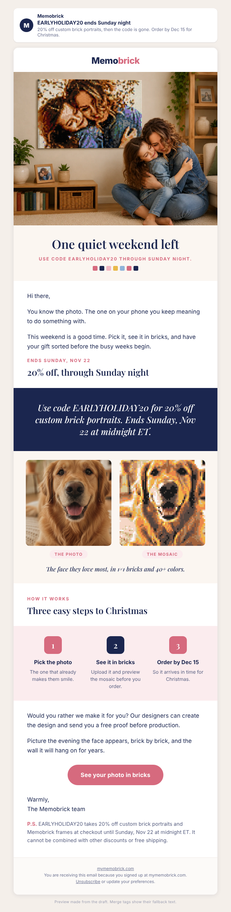

# Campaign draft: 2026-11-20 EARLYHOLIDAY20 ends Sunday (Warm)

## Preview

## Preview

(added by the preview tool)

- Requested by: none. A gap the existing schedule does not cover: nothing is sent between the Nov 19 VIP email (Past Buyers) and Black Friday (Nov 27), and the owner set EARLYHOLIDAY20 to end Sun Nov 22 (offers-calendar, 2026-10-26).
- Campaign name (Omnisend): Q4 | Nov 20 | EARLYHOLIDAY20 Ends Sunday (Warm)

## Creative concepts

1. **The last quiet weekend.** Big idea: the code ends Sunday, so this weekend is the calm moment to pick the photo before the Black Friday rush. Hook: a Friday evening, the photo you keep meaning to use. Visual: store photo of a mother and daughter hugging below their mosaic of that same hug.
2. **Who is still on the list?** Big idea: a gentle checklist for the person still without a gift. Hook: the one name left. Visual: the dog photo next to its mosaic.
3. **Grandma's wall.** Big idea: one wall, one photo of the grandkids, finished before Christmas. Visual: grandparents holding their mosaic (illustration).

Chosen: **1**. It carries the real deadline, which was the strongest lever in Memobrick's own history (Nov 2025 "Final Hours": 14 orders, about $0.064 per sent), and the hero image is a real store photo.

## Subject options

1. EARLYHOLIDAY20 ends Sunday night (32 characters, chosen)
2. Your 20% code ends this Sunday (31 characters)
3. Two days left for 20% off (25 characters)

## Subject

EARLYHOLIDAY20 ends Sunday night

## Preview text

20% off custom brick portraits, then the code is gone. Order by Dec 15 for Christmas.

## Body

<!-- hero: https://mymemobrick.com/cdn/shop/files/Custom-Bricked-Mosaic-Portrait-30x20_-Memobrick-59268336.png?width=1200 | One quiet weekend left | Use code EARLYHOLIDAY20 through Sunday night. | A mother and daughter hugging on a living room floor, below a large brick mosaic on the wall that shows the same hug -->

Hi [[contact.first_name|there]],

You know the photo. The one on your phone you keep meaning to do something with.

This weekend is a good time. Pick it, see it in bricks, and have your gift sorted before the busy weeks begin.

### Ends Sunday, Nov 22

## 20% off, through Sunday night

<!-- band: Use code EARLYHOLIDAY20 for 20% off custom brick portraits. Ends Sunday, Nov 22 at midnight ET. -->

<!-- pair: 2026-10-29-who-else-dog-photo.jpg | 2026-10-29-who-else-dog-mosaic.jpg | The face they love most, in 1×1 bricks and 40+ colors. | The photo | The mosaic -->

### How it works

## Three easy steps to Christmas

<!-- steps: Pick the photo: The one that already makes them smile. | See it in bricks: Upload it and preview the mosaic before you order. | Order by Dec 15: So it arrives in time for Christmas. -->

Would you rather we make it for you? Our designers can create the design and send you a free proof before production.

Picture the evening the face appears, brick by brick, and the wall it will hang on for years.

[See your photo in bricks](https://mymemobrick.com/collections/the-gift-for-everyone?utm_source=omnisend&utm_medium=email&utm_campaign=2026-11-code-ends-sunday)

Warmly,
The Memobrick team

P.S. EARLYHOLIDAY20 takes 20% off custom brick portraits and Memobrick frames at checkout until Sunday, Nov 22 at midnight ET. It cannot be combined with other discounts or free shipping.

## Call to action

- Button: See your photo in bricks
- Link: https://mymemobrick.com/collections/the-gift-for-everyone?utm_source=omnisend&utm_medium=email&utm_campaign=2026-11-code-ends-sunday
- Why this page: the Custom Bricks Portrait collection, where the code applies (HTTP 200 on 2026-10-27).

## Design notes

- Layout: hero with serif headline, short opening, eyebrow and headline, navy deadline band, photo-to-mosaic pair, 3-step row ending on Dec 15, optional free proof, closing line, one pink button, P.S. with code terms.
- Images:
  - Hero: `https://mymemobrick.com/cdn/shop/files/Custom-Bricked-Mosaic-Portrait-30x20_-Memobrick-59268336.png?width=1200`. Real Memobrick store product image, HTTP 200 on 2026-10-27. Alt: "A mother and daughter hugging on a living room floor, below a large brick mosaic on the wall that shows the same hug". No frame mentioned.
  - Pair: `2026-10-29-who-else-dog-photo.jpg` and `2026-10-29-who-else-dog-mosaic.jpg` (in this folder; already uploaded to Omnisend for the Oct 29 email, ids 6ad7189d266bd3daf8bb5752 and 6ad7189fc0dfbec6e740f838, so reuse those). Illustration: AI dog photo from the social planner, mosaic drawn from it in MemoBrick Studio. Not a customer.
- No person or pet is presented as a customer. No offer appears inside any image; the code is live text only.
- Omnisend: paste `2026-11-20-code-ends-sunday-omnisend.html` into a custom HTML block between the owner's header and footer, replacing the local image paths with the Omnisend image URLs.

## Offer

EARLYHOLIDAY20, 20%, ends 2026-11-22 23:59:59 ET (offers-calendar, owner's word in chat 2026-10-26). Applies only to the collections listed there. Does not combine with other discounts or free shipping. The email never says "sitewide" and does not mention Black Friday, so it does not push buyers to wait for it.

Before sending, confirm in Shopify that the end date is still Nov 22. If the owner extends the code, do not send this draft.

## Audience segment

"Warm" (Omnisend segment `6ab3a047d52351bd34134eb5`).

## Exclusions

- Past Buyers - Subscribed `6ab3a04c426f40d1edc2e690` (they get the Nov 19 VIP email the day before).
- Ordered in last 21 days - Exclude `6ab4c0626a51901673723534`.
- Unengaged 180d - Exclude `6ab3a050426f40d1edc2e691`.

## Send time (ET)

Friday 2026-11-20, 10:00 ET (15:00 UTC). No timezone optimization. Seventeen days after the Nov 3 Warm send, one day after the Nov 19 Past Buyers send, a week before Black Friday.

## Success measure

- Purchases per delivered email and revenue per recipient.
- Shopify sessions with `utm_campaign` = `2026-11-code-ends-sunday`.
- Benchmarks: Oct 20 Early Bird 0.019% orders per delivered, $0.025 per recipient; Nov 2025 "Final Hours" about $0.064 per sent.
- Target: at least 3 orders.

## Checks

- Dates: Nov 22 end and Dec 15 order-by from offers-calendar. No delivery speed, review count, quote, or scarcity beyond the real code end date.
