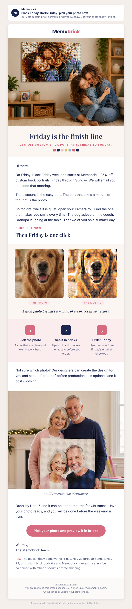

# Campaign draft: 2026-11-25 Black Friday heads-up (Warm)

## Preview

- Requested by: task board 2026-11-03 (Black Friday early-access email to the Warm list, around Nov 25). A gap: nothing is sent between the Nov 20 "code ends Sunday" email and the Nov 27 Black Friday email.
- Campaign name (Omnisend): Q4 | Nov 25 | Black Friday Starts Friday (Warm)
- Deliberate design choice: the owner set Nov 23 to 26 as a no-code window (offers-calendar), so this email does not print BRICKFRIDAY25 and does not offer early access to the discount. It tells people the 25% starts Friday and gets the photo chosen first, so Friday is a one-click order. The code arrives in the Nov 27 09:00 email.

## Creative concepts

1. **Pick the photo tonight.** Big idea: Friday's discount is the finish line; the photo is the part that takes thought, so choose it now. Hook: scrolling your camera roll on a quiet Wednesday evening. Visual: store photo of a mother and daughter hugging below their mosaic, then the dog photo next to its mosaic.
2. **The list before the rush.** Big idea: who is on your gift list, three names, one photo each. Hook: the pen and paper list on the fridge. Visual: grandparents holding a mosaic (illustration).
3. **Two days to Friday.** Big idea: countdown energy. Weakest: pushes scarcity feeling the owner did not ask for, and feels like every other Black Friday email.

Chosen: **1**, with the grandparents image as the closing moment. It matches how the product sells (the photo is the decision), keeps Friday's offer honest, and uses images we really have.

## Subject options

1. Black Friday starts Friday: pick your photo now (46 characters, chosen)
2. 25% off starts Friday. Choose your photo first. (47 characters)
3. Two days until 25% off (23 characters)

## Subject

Black Friday starts Friday: pick your photo now

## Preview text

25% off custom brick portraits, Friday to Sunday. Get your photo ready tonight.

## Body

<!-- hero: https://mymemobrick.com/cdn/shop/files/Custom-Bricked-Mosaic-Portrait-30x20_-Memobrick-59268336.png?width=1200 | Friday is the finish line | 25% off custom brick portraits, Friday to Sunday. | A mother and daughter hugging on a living room floor, below a large brick mosaic on the wall that shows the same hug -->

Hi [[contact.first_name|there]],

On Friday, Black Friday weekend starts at Memobrick: 25% off custom brick portraits, Friday through Sunday. We will email you the code that morning.

The discount is the easy part. The part that takes a minute of thought is the photo.

So tonight, while it is quiet, open your camera roll. Find the one that makes you smile every time. The dog asleep on the couch. Grandpa laughing at the table. The two of you on a summer day.

### Choose it now

## Then Friday is one click

<!-- pair: 2026-10-29-who-else-dog-photo.jpg | 2026-10-29-who-else-dog-mosaic.jpg | A good photo becomes a mosaic of 1×1 bricks in 40+ colors. | The photo | The mosaic -->

<!-- steps: Pick the photo: Faces that are clear and well lit work best. | See it in bricks: Upload it and preview the mosaic before you order. | Order Friday: Use the code from Friday's email at checkout. -->

Not sure which photo? Our designers can create the design for you and send a free proof before production. It is optional, and it costs nothing.

<!-- image: 2026-10-29-who-else-grandparents.jpg | Two grandparents smiling as they hold up a brick mosaic of their grandchildren (illustration) | An illustration, not a customer. -->

Order by Dec 15 and it can be under the tree for Christmas. Have your photo ready, and you will be done before the weekend is over.

[Pick your photo and preview it in bricks](https://mymemobrick.com/collections/the-gift-for-everyone?utm_source=omnisend&utm_medium=email&utm_campaign=2026-11-friday-25-heads-up)

Warmly,
The Memobrick team

P.S. The Black Friday code works Friday, Nov 27 through Sunday, Nov 29, on custom brick portraits and Memobrick frames. It cannot be combined with other discounts or free shipping.

## Call to action

- Button: Pick your photo and preview it in bricks
- Link: https://mymemobrick.com/collections/the-gift-for-everyone?utm_source=omnisend&utm_medium=email&utm_campaign=2026-11-friday-25-heads-up
- Why this page: the Custom Bricks Portrait collection, where BRICKFRIDAY25 applies. Last checked 200 on 2026-10-27; a 429 rate limit answered on 2026-11-03, recheck before scheduling.

## Design notes

- Layout: hero with serif headline, warm opening, eyebrow and headline, photo-to-mosaic pair, 3-step row, optional free proof, closing illustration, order-by line, one pink button, P.S. with offer terms.
- Images:
  - Hero: `https://mymemobrick.com/cdn/shop/files/Custom-Bricked-Mosaic-Portrait-30x20_-Memobrick-59268336.png?width=1200`. Real Memobrick store product image, HTTP 200 on 2026-11-03. Same hero as the Nov 20 email to the same Warm list: swap it if the owner wants variety.
  - Pair: `2026-10-29-who-else-dog-photo.jpg` and `2026-10-29-who-else-dog-mosaic.jpg`. Illustration: AI dog photo from the social planner, mosaic made from it. Not a customer. Already uploaded to Omnisend for Oct 29.
  - Closing image: `2026-10-29-who-else-grandparents.jpg`. AI illustration, labeled as such, not a customer. Already in this folder from the Oct 29 email; upload if not in Omnisend.
- No offer appears inside any image. The code is not printed anywhere in this email.
- Omnisend: paste `2026-11-25-friday-25-heads-up-omnisend.html` into a custom HTML block between the owner's header and footer, replacing local image paths with Omnisend image URLs.

## Offer

BRICKFRIDAY25, 25%, Fri Nov 27 00:00 ET to Sun Nov 29 23:59:59 ET (offers-calendar). Applies to the same collections as EARLYHOLIDAY20, does not combine with other discounts or free shipping. This email names the 25% and dates but not the code, because Nov 23 to 26 is the owner's no-code window. If the owner prefers to print the code now, say so and this draft changes.

## Audience segment

"Warm" (Omnisend segment `6ab3a047d52351bd34134eb5`).

## Exclusions

- Ordered in last 21 days - Exclude `6ab4c0626a51901673723534`.
- Unengaged 180d - Exclude `6ab3a050426f40d1edc2e691`.
- Past Buyers - Subscribed `6ab3a04c426f40d1edc2e690` (they get the Nov 19 VIP email).

## Send time (ET)

Wednesday 2026-11-25, 10:00 ET (15:00 UTC). No timezone optimization. Warm gets Nov 20, Nov 25, Nov 27, Nov 30: four in ten days, the tightest stretch of the year. Eden can drop this one if she wants only three.

## Success measure

- Purchases per delivered email and revenue per recipient, and orders in the 48 hours that follow.
- Shopify sessions with `utm_campaign` = `2026-11-friday-25-heads-up`.
- Benchmarks: Oct 20 Early Bird 0.019% orders per delivered, $0.025 per recipient; Nov 2025 "Final Hours" about $0.064 per sent.
- Honest expectation: few orders on the day (no code). The goal is more people starting a design before Friday and a stronger Nov 27 send.

## Checks

- Dates: Nov 27 to 29 and Dec 15 from offers-calendar. No delivery speed, review count, quote, or invented scarcity.
