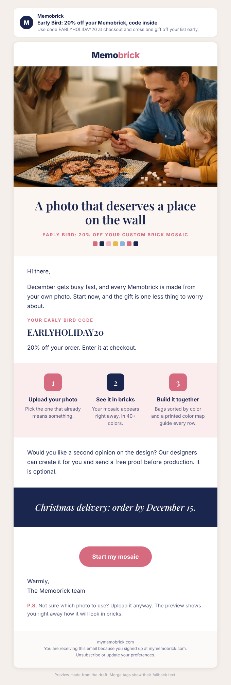

# Improvement: Q4 | Oct 20 | Early Bird 15% (Warm + Past Buyers)

## Preview

- Omnisend campaign ID: 6ab3ae8ca46e779522c6446f (status scheduled, Tue 2026-10-20 11:00 ET, 15:00 UTC)
- Audience and exclusions: unchanged (Warm + Past Buyers; excludes Unengaged 180d).
- Status: proposal. Nothing in Omnisend has been changed.

## Why change it

The owner's public holiday offer, EARLYHOLIDAY20 (20% off, no minimum), went live on 2026-10-12 and is listed active in `offers-calendar.md`. This scheduled email still tells the same people they get 15% with a personal code ("this week only", code expires Oct 28). Two problems:

1. A subscriber who has seen 20% on the site or in ads receives a smaller offer in the inbox, from the same brand, a week later. That is a reason to wait, or to feel shortchanged, not a reason to order.
2. The email says "this week only" and "expires October 28", while the live 20% code has no confirmed end date. The 15% figure and the personal-code mechanic are not in `offers-calendar.md`.

Sales context: October 1 to 12 is 34 orders against a goal of 60, and the Warm segment (about 5,000 people, 50 to 55% opens) has produced 1 attributed order from its last two sends. This is the biggest scheduled send in the next two weeks, so the offer in it matters.

Both banner images in the current email (`6ab4be7c...` and `6ab4be85...`) have "15%" baked into the picture, so the offer cannot be fixed by editing text alone. The after version replaces both with text-free product photos.

## Before (current, read from Omnisend 2026-10-13)

- Subject: 🐦 Early Bird: 15% off your Memobrick (this week only)
- Preview text: Your personal 15% code is inside. This week only.
- Top banner image (alt: "Early birds get 15% off. Beat the holiday rush.")
- Intro: "Hi [first name], every Memobrick is made from your own photo, and December gets busy fast. Design yours this week, lock in 15% off, and cross one gift off your list early."
- Discount block: Omnisend-generated personal code, 15%, "Your personal code expires October 28", button "Claim my 15% →"
- Second banner image (alt: "A brick-built early bird: 15% off your Memobrick this week only")
- How it works image, two size cards (16×16 from $69.88, 20×20 from $99.88), buttons "Use my code →" and "See bigger sizes"
- Blue strip: "Christmas delivery: order by December 15"
- Footer note: "One code per customer. Not combinable with other offers."

## After (proposed)

Edit steps, only after approval: `post_campaigns_id_restore_to_draft`, replace the email content (`put_email_content_id`, full document, keeping the owner's header, footer, fonts and colors), patch nothing else, then `post_campaigns_id_send` with the same scheduled time (2026-10-20T15:00:00Z). Remove the Omnisend discount block, because the code is the public Shopify code EARLYHOLIDAY20. Remove both "15%" banner images. Keep the footer and unsubscribe link.

## Subject

Early Bird: 20% off your Memobrick, code inside

## Preview text

Use code EARLYHOLIDAY20 at checkout and cross one gift off your list early.

## Body

<!-- hero: https://mymemobrick.com/cdn/shop/files/Art-Gift-Kit-_-Buy-Now_-Personalise-Later-Memobrick-62824746.png?crop=region&crop_left=0&crop_top=472&crop_width=1024&crop_height=604&width=1200 | A photo that deserves a place on the wall | Early Bird: 20% off your custom brick mosaic | A mother, father and toddler around a table, passing a single brick over their half-built photo mosaic -->

Hi [[contact.first_name|there]],

December gets busy fast, and every Memobrick is made from your own photo. Start now, and the gift is one less thing to worry about.

### Your Early Bird code

## EARLYHOLIDAY20

20% off your order. Enter it at checkout.

<!-- steps: Upload your photo: Pick the one that already means something. | See it in bricks: Your mosaic appears right away, in 40+ colors. | Build it together: Bags sorted by color and a printed color map guide every row. -->

Would you like a second opinion on the design? Our designers can create it for you and send a free proof before production. It is optional.

<!-- band: Christmas delivery: order by December 15. -->

[Start my mosaic](https://mymemobrick.com/?utm_source=omnisend&utm_medium=email&utm_campaign=2026-10-early-bird-20)

Warmly,
The Memobrick team

P.S. Not sure which photo to use? Upload it anyway. The preview shows you right away how it will look in bricks.

## Call to action

- Button: Start my mosaic
- Link: https://mymemobrick.com/?utm_source=omnisend&utm_medium=email&utm_campaign=2026-10-early-bird-20
- The code is typed by the customer at checkout. If the owner knows a link that applies EARLYHOLIDAY20 automatically (a Shopify discount link), use that link instead with the same UTM.

## Design notes

- Hero: real store photo `Art-Gift-Kit-_-Buy-Now_-Personalise-Later-Memobrick-62824746.png`, cropped by the store image service (URL returned 200 on 2026-10-13). A Memobrick product photo, not a customer; no names or quotes attached.
- Alt text is on the hero. The code is real text, not part of any image, so it works with images off.
- No prices are quoted (not re-verified in Shopify today). No frame is shown or implied.
- Dec 15 order-by date and the free design proof are both owner-confirmed Facts.
- Omnisend: paste `improve-oct20-early-bird-omnisend.html` into a custom HTML block between the owner's header and footer.

## Offer

EARLYHOLIDAY20, 20% off, active per `offers-calendar.md` (start 2026-10-12, end date unconfirmed). The email states no end date and no "this week only", so it stays true whatever end date the owner sets. Not stacked with the automated 20% recovery or reactivation codes (this email does not add a second code).

Owner decision attached to this item: if EARLYHOLIDAY20 will end before Oct 20, do not approve; tell the coordinator the end date and this email will be redrafted.

## Related, not proposed here

- "Q4 | Oct 27 | Early Bird LAST CALL 15%" (6ab5038abbe86b0610261a72) has the same 15% and "ends tomorrow" issue. It should follow whatever the owner decides for Oct 20, and "ends tomorrow" can only be used once EARLYHOLIDAY20's end date is in `offers-calendar.md`.
- "Q4 | Oct 13 | Real Customer Builds" sends today at 11:00 ET. Its content has no offer, but it includes a banner image with the claim "Thousands of satisfied customers with their Memobrick mosaics" (unverified; image id 6a5fb754fc0604effc0fddf2) and it implies a Dec 15 order-by date (now a verified Fact). Approval cannot arrive before it sends, so the owner may want to look at it directly in Omnisend.

## Success measure

Purchases per delivered email and revenue per recipient. Benchmark: Oct 6 Gift Guide Launch, $0.016 revenue per recipient and 1 order from 4,914 delivered. Target: beat both.
