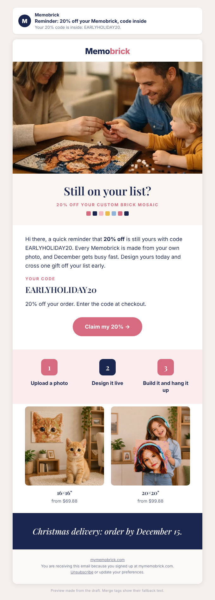

# Improvement: Q4 | Oct 27 | Early Bird LAST CALL 15% (replaces booster)

## Preview

- Omnisend campaign ID: 6ab5038abbe86b0610261a72 (read 2026-10-20 03:25 ET: status scheduled, Tue 2026-10-27 11:00 ET, 15:00 UTC)
- Audience and exclusions: unchanged. Includes Warm (`6ab3a047d52351bd34134eb5`) and Past Buyers - Subscribed (`6ab3a04c426f40d1edc2e690`); excludes Unengaged 180d (`6ab3a050426f40d1edc2e691`) and Ordered in last 21 days (`6ab4c0626a51901673723534`).
- Send time: unchanged, Tue 2026-10-27 11:00 ET.
- Status: applied 2026-10-20 03:29 ET; read back as scheduled for 2026-10-27 15:00 UTC with the 20% content.
- Approval: A-2026W42-041 (owner, 2026-10-20): replace the 15% offer with EARLYHOLIDAY20 20% and remove "this week only" and any end-date wording; keep layout, audience and send time; minimal text changes only.

## What changes, and only this

The owner's layout stays: logo, top banner, intro line, dashed code box with button, strip, "How it works" image, two size cards with prices and buttons, blue Christmas strip, footer. Only offer wording changes:

| Where | Before | After |
|---|---|---|
| Subject | ⏰ Last call: 15% off your Memobrick ends tomorrow | Reminder: 20% off your Memobrick, code inside |
| Preview text | Last call: your personal 15% code is inside. | Your 20% code is inside: EARLYHOLIDAY20. |
| Top banner image | Banner with "15%" printed in the picture (alt "Early birds get 15% off. Beat the holiday rush.") | Text-free store photo of a family building their mosaic (same photo as the Oct 20 email) |
| Intro | ...this is your last call for **15% off**. ...Design yours today... | ...a quick reminder that **20% off** is still yours with code EARLYHOLIDAY20. ...Design yours today... |
| Code box | Omnisend personal 15% code, button "Claim my 15% →", note "Last call: use your personal code before it's gone" | Same dashed box with the public code **EARLYHOLIDAY20**, button "Claim my 20% →", note "20% off your order. Enter the code at checkout." |
| Second banner image | Brick-built early bird with "15% off" printed in the picture | Removed (the offer is printed inside the image, so it cannot be reworded). The decorative strip above it stays. |
| Footer | "One code per customer. Not combinable with other offers." | Line removed: it described the personal Omnisend code; EARLYHOLIDAY20's combination terms are not in `offers-calendar.md`. |

Unchanged: "How it works" image, size cards (16×16" from $69.88, 20×20" from $99.88) and their buttons ("Use my code →" still makes sense with a public code), "Christmas delivery: order by December 15" strip, social icons, address and unsubscribe link, sender, campaign name.

Why "last call" and "ends tomorrow" go: EARLYHOLIDAY20 has no end date (`offers-calendar.md`; Shopify shows no end date). Telling people it ends would be invented scarcity. The alarm clock emoji in the subject goes for the same reason.

Images: the two old banners carry "15%" inside the picture, so the offer could not be fixed in text alone. The replacement photo is a real Memobrick store image (`Art-Gift-Kit-_-Buy-Now_-Personalise-Later-Memobrick-62824746.png`, cropped by the store image service, HTTP 200 on 2026-10-20), shows no offer, and presents no one as a customer.

## Subject

Reminder: 20% off your Memobrick, code inside

## Preview text

Your 20% code is inside: EARLYHOLIDAY20.

## Body

<!-- hero: https://mymemobrick.com/cdn/shop/files/Art-Gift-Kit-_-Buy-Now_-Personalise-Later-Memobrick-62824746.png?crop=region&crop_left=0&crop_top=472&crop_width=1024&crop_height=604&width=1200 | Still on your list? | 20% off your custom brick mosaic | A mother, father and toddler around a table, passing a single brick over their half-built photo mosaic -->

Hi [[contact.first_name|there]], a quick reminder that **20% off** is still yours with code EARLYHOLIDAY20. Every Memobrick is made from your own photo, and December gets busy fast. Design yours today and cross one gift off your list early.

### Your code

## EARLYHOLIDAY20

20% off your order. Enter the code at checkout.

[Claim my 20% →](https://mymemobrick.com/?utm_source=omnisend&utm_medium=email&utm_campaign=2026-10-early-bird-last-call-20)

<!-- steps: Upload a photo | Design it live | Build it and hang it up -->

<!-- products:
     https://mymemobrick.com/cdn/shop/files/Custom-Memobrick-Photo-Mosaic-16x16.png?width=600 | 16×16" | from $69.88 | https://mymemobrick.com/products/1-big-board
     https://mymemobrick.com/cdn/shop/files/Custom-Memobrick-Photo-Mosaic-20x20.png?width=600 | 20×20" | from $99.88 | https://mymemobrick.com/products/2-2-boards -->

<!-- band: Christmas delivery: order by December 15. -->

## Design notes

- The preview above is drawn with the Memobrick preview tool, so its fonts and colors are the house preview style, not the owner's Omnisend template. In Omnisend the owner's own blocks, fonts and colors stay; the "How it works" row is the owner's existing image and the size cards are the owner's existing images. The heading "Still on your list?" exists only in this preview (the owner's email has no heading here) and is not added in Omnisend.
- In Omnisend: the top banner becomes a custom HTML block holding the store photo (alt: "A mother, father and toddler around a table, passing a single brick over their half-built photo mosaic"); the discount block becomes a custom HTML block with the same dashed blue box, the code in live text, the pink button and the note. The code works with images off.
- Button link: `https://mymemobrick.com/?utm_source=omnisend&utm_medium=email&utm_campaign=2026-10-early-bird-last-call-20` (same destination as before, the home page, with a UTM tag).
- No person is presented as a customer; no offer is printed inside any image.

## Offer

EARLYHOLIDAY20, 20% off, active per `offers-calendar.md` (start 2026-10-12, no end date set). No end date, deadline or "this week only" is stated. This email adds no second code, so nothing stacks with the automated 20% recovery or reactivation codes.

## Success measure

Purchases per delivered email and revenue per recipient, compared with the Oct 20 Early Bird send to the same audience.
