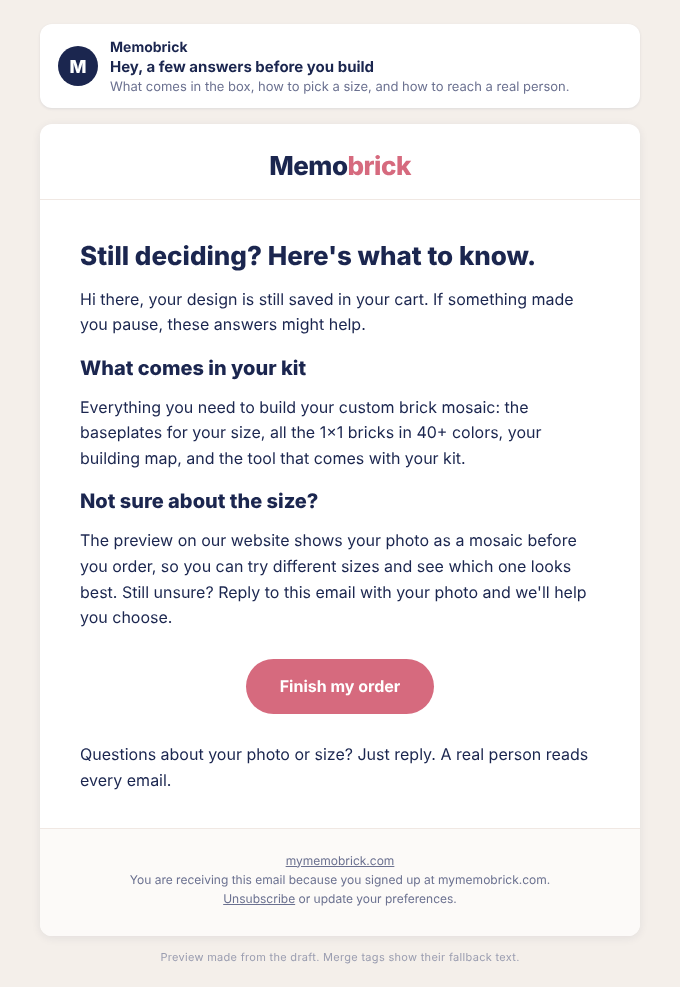

# Test: Abandoned Cart last email, reassurance vs 20% discount

## Preview

DRY RUN draft. Experiment ID: EFO-20261011-01. Status: proposed, not started.

## Where

- Flow: Abandoned Cart (3 emails, 20% in last), Omnisend ID 64e86fedc0c2565cbe9d8ac8
- Email: block `6fURGj3D` (third email, sent 48 h after email 2), content ID 682df212144897d7fd85953a
- Why this flow and not Abandoned Checkout: the cart last email has slightly more volume (88 vs 76 delivered in 90 days), and the checkout flow already converts in emails 1 and 2, so testing there puts more at risk.

## Hypothesis

Shoppers who leave a custom photo kit in the cart hesitate because they are unsure about size, what arrives in the box, and how the mosaic will look, not because of price. A last email that answers those questions will get at least as many purchases per delivered email as the 20% discount, without the discount cost.

Baseline (last 90 days, mostly older content): 88 delivered, 26 opens, 0 clicks, 0 purchases.

## The one variable

The offer block and the copy that frames it: 20% discount (control) vs reassurance with no discount (variant). Everything else stays the same in both arms: send timing, sender, header image, cart product block, footer.

Precondition: the shared blocks in the control currently contain claims that `memobrick-brand` does not allow (Miami shipping, "2–4 business days", "designers" making a "free proof", 740+ reviews, named quotes without recorded permission). The owner must first approve removing or verifying those blocks in the control, so both arms share the same compliant base. Otherwise the test would compare two things at once.

## Original copy (control, live today)

Subject: `[[contact.first_name|default:"Hey"]], 20% off your Memobrick (3 days)`

Preheader: `Your personal code is inside, and your design is still saved.`

Headline: `Here's 20% off to finish it.`

Body: `Hi [[contact.first_name|default:"there"]], this is the last reminder about your cart. Your code takes 20% off for the next 3 days, and your design is still saved.`

Discount block: `20% off everything in your cart` / `[code]` / button `Use my 20% off` / `Your personal code expires in 3 days`

(Followed by the saved-design image, ratings line, FAQ, quote, designer-proof block, cart product block, and footer, shared with the variant once cleaned up.)

## New copy (variant)

Subject: `[[contact.first_name|default:"Hey"]], a few answers before you build`

Preheader: `What comes in the box, how to pick a size, and how to reach a real person.`

Headline: `Still deciding? Here's what to know.`

Body: `Hi [[contact.first_name|default:"there"]], your design is still saved in your cart. If something made you pause, these answers might help.`

Block 1, heading: `What comes in your kit`

Block 1, body: `Everything you need to build your custom brick mosaic: the baseplates for your size, all the 1×1 bricks in 40+ colors, your building map, and the tool that comes with your kit.`

Block 2, heading: `Not sure about the size?`

Block 2, body: `The preview on our website shows your photo as a mosaic before you order, so you can try different sizes and see which one looks best. Still unsure? Reply to this email with your photo and we'll help you choose.`

Block 3, heading: `When will it arrive?`

Block 3, body: omitted. The Facts table in `offers-calendar.md` has no verified production or delivery timing, so this block stays out until the owner adds one. If the owner adds a verified timing, insert it here exactly as written in the Facts table.

Button: `Finish my order` (link: the cart-restore link from review improvement 1 once fixed; until then the same cart link the control uses)

Closing line: `Questions about your photo or size? Just reply. A real person reads every email.`

No discount block. No discount code is generated in this arm.

## Audience split

- Everyone who reaches the third step of the Abandoned Cart flow (not exited by an order or a started checkout).
- 50/50 random split just before the third email, using an Omnisend split block. Not yet confirmed that a random split block is available through the API; if it is not, the owner sets it up in the Omnisend editor.
- No other flow changes while the test runs (one flow test at a time).

## Primary metric

Purchases per delivered email for the third email, per arm (Omnisend attributed orders / delivered), from `post_analytics_reports` grouped by `messageID`.

## Guardrails

- Unsubscribes: stop if the variant's unsubscribe rate is above 1% and above the control's by 0.5 percentage points or more, with at least 50 delivered per arm.
- Complaints: stop immediately on 2 or more spam complaints in either arm.
- Discount cost: record the total discount value redeemed from the control arm's codes (Shopify discounts, aggregate only) so the saving is known if the variant holds up.
- Revenue per recipient for the whole cart flow, per arm, as a secondary check.

## Minimum run time

At least 8 weeks and at least 100 delivered per arm, whichever comes later. At the current volume (about 1 delivered last email per day, 0.5 per arm) 100 per arm takes about 28 weeks. Holiday traffic may shorten that. Be clear about this: the test can only catch a large difference, and a result of "inconclusive" is likely.

## Decision rule

Checked only after the minimum run time is met:

- **Variant adopted:** variant purchases are equal to or higher than control purchases, and no guardrail was breached. Since it costs no discount, a tie favors the variant.
- **Control kept:** control has 3 or more purchases more than the variant.
- **Inconclusive:** anything else (control ahead by 1 or 2). Record it as inconclusive. The owner chooses to extend to 200 per arm or stop.

No winner is named before this rule is met.
