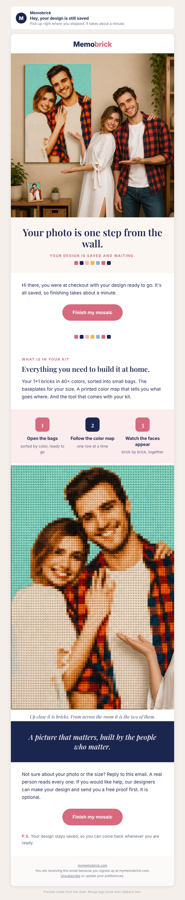

# Checkout email 1, designed clean version

## Preview

## Creative concepts

1. **The wall.** Big idea: your photo is one step from hanging in your home. Hook: seeing the finished piece on a wall. Visual: the live product photo of a mosaic portrait on a wall (hero), the mosaic crop alone as the supporting image.
2. **The table.** Big idea: the evening you build it together. Hook: bricks sorted in little bags, someone reading the next row. Visual: needs a build photo we do not have in the shop files; would need an owner still or an AI illustration.
3. **The saved design.** Big idea: it is waiting for you. Hook: your own design, saved. Visual: the personalized saved-design block (already in the live email).

Chosen: 1 for the opening, with 3 kept right under it as the live personalized block, and a line of 2 in the copy. It makes the keepsake feel real with an image we really have.

## Subject

[[contact.first_name|default:"Hey"]], your design is still saved

## Subject alternatives

- One step left to your mosaic
- Your photo is waiting in bricks

## Preview text

Pick up right where you stopped. It takes about a minute.

## Body

<!-- hero: https://mymemobrick.com/cdn/shop/files/Custom-Bricked-Mosaic-Portrait-20x40_-Memobrick.png?width=1200 | Your photo is one step from the wall. | Your design is saved and waiting. | A custom brick mosaic portrait of a smiling couple hanging on a living room wall -->

Hi there, you were at checkout with your design ready to go. It's all saved, so finishing takes about a minute.

[Finish my mosaic](https://mymemobrick.com/checkout)

<!-- divider -->

### What is in your kit

## Everything you need to build it at home.

Your 1×1 bricks in 40+ colors, sorted into small bags. The baseplates for your size. A printed color map that tells you what goes where. And the tool that comes with your kit.

<!-- steps: Open the bags: sorted by color, ready to go | Follow the color map: one row at a time | Watch the faces appear: brick by brick, together -->

<!-- image: https://mymemobrick.com/cdn/shop/files/Custom-Bricked-Mosaic-Portrait-20x40_-Memobrick.png?crop=region&crop_left=108&crop_top=80&crop_width=507&crop_height=755&width=700 | A mosaic portrait of a couple made of small 1×1 bricks | Up close it is bricks. From across the room it is the two of them. -->

<!-- band: A picture that matters, built by the people who matter. -->

Not sure about your photo or the size? Reply to this email. A real person reads every one. If you would like help, our designers can make your design and send you a free proof first. It is optional.

[Finish my mosaic](https://mymemobrick.com/checkout)

P.S. Your design stays saved, so you can come back whenever you are ready.

## Design notes

- The live personalized block (last_design_image, "Saved and waiting to be built") stays directly under the first paragraph in Omnisend; the preview cannot render it, so the hero stands in.
- Image 1: live product photo, https://mymemobrick.com/cdn/shop/files/Custom-Bricked-Mosaic-Portrait-20x40_-Memobrick.png (200), shown as a product image, not as a customer. Alt text in the hero line.
- Image 2: same file, cropped to the mosaic (crop URL, 200). Alt text in the block.
- No offer, no code, no review count, no press, no timing. Button link in Omnisend is [[event.raw.abandoned_checkout_url]].
